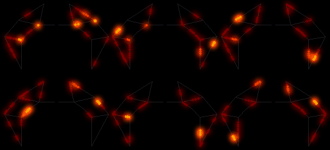
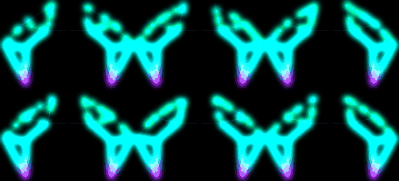
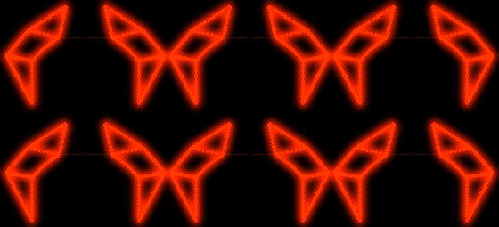
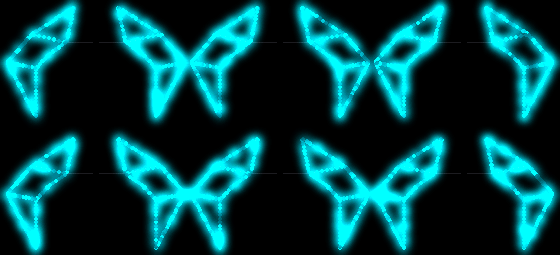

# beast-illumination

[](https://github.com/polilya/beast-illumination/actions/workflows/ci.yml)

Lighting for a walking robot crab (January–February 2024): 12 linkage legs, each lined with 102 WS2812B LEDs (1,224 in total), driven by one ESP32. The firmware runs 11 lighting modes, drives all 12 strips in parallel, keeps the current inside the power supply's budget, takes commands from a phone over Wi-Fi and reacts to music through an I2S microphone.

**[Open the browser simulator →](https://polilya.github.io/beast-illumination/)** It runs the firmware's own effect code, compiled to WebAssembly.


| Fire waves | Purple wave |
|---|---|
|  |  |
| **Heartbeat** | **Bioluminescence** |
|  |  |

*Previews rendered by [`tools/render_gif.py`](tools/render_gif.py) from the firmware effect engine, drawn on the leg geometry traced from a photo of the built leg.*

## How it is built

```
ESP32 ── GPIO ×12 ──► 12 strips × 102 WS2812B (one per leg), sent in parallel over I2S0
  │
  ├── I2S1 ◄── INMP441 microphone (FFT → bass / mid / treble, beat detection)
  └── Wi-Fi access point ──► control page on the phone
```

| Part | What it does |
|---|---|
| [`firmware/lib/crabfx`](firmware/lib/crabfx/src) | Effect engine with no hardware dependencies: the 11 effects, gamma correction, power model and limiter, FFT and beat detector. Runs on the ESP32, on a PC (tests, GIFs) and in the browser (WebAssembly). |
| [`firmware/src`](firmware/src) | ESP32 side: FastLED parallel I2S output, Wi-Fi control page, microphone task, settings kept in flash. |
| [`firmware/test`](firmware/test/test_core/test_main.cpp) | 19 unit tests run on the host: palettes, timing, gait, gamma, power limiter, FFT, beat detection, determinism of every mode. |
| [`simulator`](simulator) | Browser simulator: the engine compiled with Emscripten, drawn on the real leg geometry. It can listen to the computer's microphone through the same analyser the ESP32 uses. |
| [`legacy`](legacy) | The original MicroPython and Arduino prototypes, kept as written (first developed in the [Wokwi](https://wokwi.com/) simulator). |

### From prototypes to firmware

The first version was a set of standalone scripts, one per effect, each looping with `sleep()` and writing the legs one after another. The rewrite keeps each effect's look and parameters but changes how it runs:

- **Non-blocking.** Every effect is a state machine that is given the current time and advances by however many of its own steps are due. The main loop never sleeps, so the Wi-Fi page and the microphone keep working, and one speed multiplier applies to every mode.
- **Parallel output.** Sending 102 LEDs takes about 3 ms; twelve legs one after another took 37 ms or more, so the legs updated out of step. FastLED's I2S driver sends all 12 data lines at once.
- **Gamma and power.** Fades are gamma-corrected (2.2), and a power manager keeps every frame inside separate peak and average limits (see below), set from the phone.
- **Leg geometry.** Each strip runs as four sections along the leg linkage (addresses below). Effects use them: the purple wave starts at the foot tip and climbs both edges of the foot, in each leg at the moment that foot touches the ground (the crank turn is timed for now, and the gait phases are an assumption, `kLegTouchdown` in [`effects.cpp`](firmware/lib/crabfx/src/effects.cpp)); the muscle wave runs along each section with a delay from leg to leg, like a gait.

| Addresses | Section |
|---|---|
| 0–29 | top triangle (data enters at the bottom of its vertical edge) |
| 30–66 | upper link, then the outer edge of the foot down to the tip |
| 67–91 | inner edge of the foot, then the curved link back up |
| 92–101 | top edge of the foot |

## Power

A WS2812B draws up to ~20 mA per colour channel at full duty plus ~1 mA when dark. With 1,224 LEDs, full white would need **~75 A at 5 V**, so the limit is part of the design, not an afterthought. Draw of each mode before the limiter, at full brightness and at 39 % (after gamma correction, same model, 28 s of each mode):

| Mode | 100 %: mean / peak, A | 39 %: mean / peak, A |
|---|---|---|
| Fire waves | 2.2 / 2.4 | 1.3 / 1.4 |
| Fire sparks | 31.8 / 33.3 | 5.2 / 5.4 |
| Bioluminescence | 20.1 / 21.4 | 3.6 / 3.7 |
| Breathing | 23.7 / 50.8 | 4.0 / 7.6 |
| Disco | 11.6 / 11.9 | 2.5 / 2.6 |
| Resonance | 2.2 / 3.7 | 1.3 / 1.5 |
| Heartbeat | 8.3 / 26.2 | 2.1 / 4.4 |
| Muscle wave | 5.3 / 7.6 | 1.7 / 2.0 |
| Muscle wave (colours) | 36.9 / 42.3 | 5.6 / 6.3 |
| Purple wave | 14.9 / 15.6 | 3.0 / 3.1 |
| Sound reactive | 5.7 / 7.6 | 1.8 / 2.1 |

Because of gamma correction, 39 % brightness is about 13 % PWM duty, so the draw falls much faster than the brightness the eye sees. About 1.2 A of every figure is the LEDs' quiescent current, drawn even when they are dark.

### Power management

A fixed low brightness keeps the current down but makes every mode dim all the time, even the ones that draw little. The firmware instead lets the light stay bright and pays for the peaks, in three layers ([`output.cpp`](firmware/lib/crabfx/src/output.cpp)):

1. **Peak and average are separate limits.** The converter and wiring set the peak; the battery and the heat in the strips care about the average. A burst reserve lets short bright moments (a heartbeat, a flash) go up to the peak and refills whenever the draw is below the average. As the reserve runs down, the ceiling slides from the peak to the average, so a long burst fades instead of hitting a wall. The long-run average cannot exceed the average limit plus one reserve.
2. **White trim before dimming.** A pixel's white part, `min(r, g, b)`, costs all three channels. When a frame is over the ceiling, up to 40 % of that white part is removed first, which makes colours a little more saturated rather than darker. Only then is the frame dimmed.
3. **Smooth release.** Dimming applies at once (the ceiling is never exceeded) but recovers over ~0.5 s, so a mode hovering at the limit does not pump.

Optionally each group of legs on its own converter gets its own peak limit (`legs_per_supply`, `supply_peak_ma`). Three profiles are starting points to match to the real battery and converters: **Eco** (71 % brightness, 6 A average, 12 A peak), **Normal** (86 %, 12 / 20 A) and **Show** (100 %, 20 / 30 A).

Eco against simply turning brightness down to 39 %, over 58 s of each mode. Perceived brightness counts the dimming through the eye's response (duty^(1/2.2)):

| Mode | 39 % flat: mean / peak, A | Eco: mean / peak, A | Eco: perceived brightness, mean (lowest) |
|---|---|---|---|
| Fire waves | 1.3 / 1.4 | 1.7 / 1.8 | 71 % (71 %) |
| Fire sparks | 5.3 / 5.4 | 6.3 / 10.6 | 45 % (43 %) |
| Bioluminescence | 3.6 / 3.7 | 6.2 / 9.6 | 55 % (53 %) |
| Breathing | 4.1 / 7.6 | 6.0 / 9.5 | 57 % (39 %) |
| Disco | 2.5 / 2.5 | 6.0 / 6.2 | 71 % (71 %) |
| Resonance | 1.3 / 1.5 | 1.7 / 2.4 | 71 % (71 %) |
| Heartbeat | 2.1 / 4.4 | 4.3 / 11.9 | 70 % (68 %) |
| Muscle wave | 1.7 / 2.0 | 3.1 / 4.2 | 71 % (71 %) |
| Muscle wave (colours) | 5.7 / 6.7 | 6.2 / 9.4 | 46 % (43 %) |
| Purple wave | 3.0 / 3.1 | 6.3 / 7.8 | 64 % (61 %) |
| Sound reactive | 1.8 / 2.0 | 3.3 / 4.2 | 71 % (71 %) |

For about the same average current, every mode is brighter than 39 %, from 45 % in the most demanding modes up to the full 71 % in the light ones, and the heartbeat keeps its flashes by drawing on the reserve. The limits act on a model of the LEDs, not a measurement: check the real draw once with a clamp meter and adjust `PowerModel` if it differs.

At high draw, feed power into each strip at both ends: thin strip copper drops enough voltage over 102 LEDs to shift the colours at the far end.

## Wiring

| Signal | ESP32 GPIO |
|---|---|
| Leg strips 1–12 | 2, 4, 5, 12, 13, 14, 15, 18, 19, 21, 22, 23 |
| INMP441 SCK / WS / SD | 26 / 25 / 33 (L/R to GND) |

GPIO 2, 5, 12 and 15 are strapping pins. If a strip pulls GPIO 12 high during reset, the ESP32 selects 1.8 V flash and does not boot. Use a series resistor (~330 Ω) on every data line and power the strips after the controller, or move those legs to other pins. WS2812B needs a data high level of 0.7 × VDD; at 5 V a level shifter (74AHCT125) is more reliable than the ESP32's 3.3 V output.

## Build, flash, simulate

```bash
cd firmware
pio test -e native          # unit tests on the host
pio run -e esp32 -t upload  # build and flash
```

Then join the `beast-crab` Wi-Fi network (change the password in `config.h` first) and open http://192.168.4.1.

```bash
bash simulator/build.sh                       # needs Emscripten
python3 -m http.server -d simulator 8000      # open http://localhost:8000
python3 tools/render_gif.py                   # regenerate the README previews
```

## Status

The firmware builds and the engine is tested on the host and in the browser. The rewritten firmware (2026) has not yet run on the physical sculpture; the prototypes in [`legacy/`](legacy), written in January–February 2024, are what drove it.
